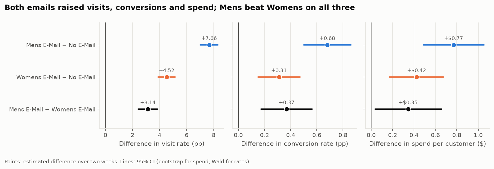
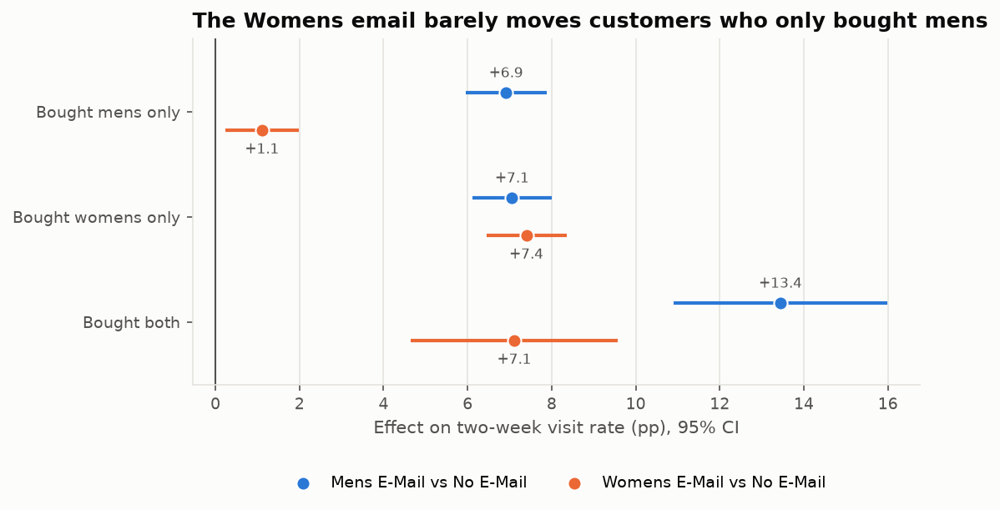
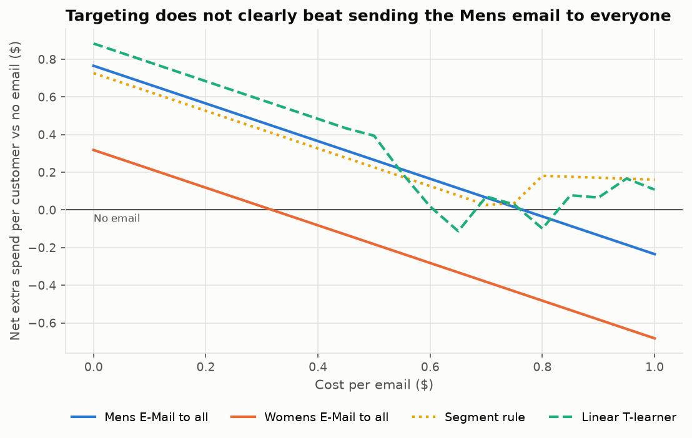

# Hillstrom Email Campaign: A/B Test and Uplift Analysis

End-to-end analysis of a randomized email experiment with 64,000 customers: did the emails work, by how much, and **who should get which email**? Python, SQL (DuckDB), statsmodels, scikit-learn.

*Personal portfolio project.*

## Key results

Over the two weeks after sending, compared with no email:

| | Mens email | Womens email |
|---|---|---|
| Visit rate | **+7.7 pp** (10.6% → 18.3%) | +4.5 pp |
| Conversion rate | **+0.68 pp** (0.57% → 1.25%) | +0.31 pp |
| Spend per customer | **+$0.77** (95% CI $0.49 to $1.05) | +$0.42 ($0.17 to $0.68) |

1. **Both emails work, and the Mens email is the stronger campaign.** All 9 tests (3 comparisons × 3 metrics) stay significant after a Holm multiple-comparison correction. The experiment itself checks out: no sample ratio mismatch (p = 0.90), and covariates are balanced (largest standardized difference 0.016).
2. **One customer trait clearly changes the response: past purchase category.** The Womens email barely moves customers who have only bought men's items (+1.1 pp visits vs about +7 pp for everyone else). The Mens email works for every group.
3. **A machine-learning uplift model did not beat a simple three-group rule.** The planned gradient-boosting T-learner overfit (its training-set gain was about 20 times its test-set gain). A linear T-learner fixed that and beats random targeting on visits, but it ties with a rule based on past purchase category alone. No model could rank customers by *spend* uplift better than random: with ~1% of customers buying, there are a few dozen buyers per arm in the test set.
4. **Recommendation: send the Mens email to everyone, unless emails are expensive.** No targeting policy measurably beats it at any email cost from $0 to $1. Don't send the Womens email to mens-only buyers. Targeting only the customers who bought both categories is a plausible option when the cost per email approaches the Mens email's break-even, but it needs a follow-up test to confirm.
5. **Variance reduction barely helps here, and the power analysis explains why spend is hard.** CUPED with past-year spend removes under 0.5% of the variance (the covariates predict two-week behaviour poorly). Detecting a $0.10 spend effect would take about 211,000 customers per arm, ten times this experiment. The Mens vs Womens spend comparison had only ~58% power, so the observed $0.35 gap is probably an overestimate.







## What this analysis does not claim

- **Nothing beyond two weeks.** Long-term effects (purchases pulled forward, unsubscribes, email fatigue) are not in the data.
- **Revenue, not profit.** Spend is revenue; margins and real email costs are unknown, so costs are shown as a range.
- **No causal claims about basket size.** Spend among converters is compared descriptively only, since conversion is itself affected by the email.
- **Why customers differ.** Segment and model results describe *who* responds more, not *why*.
- **A perfectly clean model comparison.** After the first uplift model overfit, a second one was evaluated on the same test set. This is disclosed in notebook 06, along with how the selection should be done next time.
- **Today's numbers.** The experiment ran in 2008.

## Methods at a glance

| Step | Method | Why this one |
|---|---|---|
| Data prep | DuckDB SQL: typed load, cleaning, data-quality checks, `UNPIVOT` segment summaries | Saved `.sql` files, no database server needed |
| Validity | Chi-square SRM test; standardized mean differences | SMD measures the size of imbalance, unlike per-variable p-values |
| Main effects | Wald CIs for rates; percentile bootstrap CIs and Welch tests for spend; Holm correction | Spend is ~99% zeros and skewed; 9 confirmatory tests need family-wise error control |
| Variance reduction | CUPED; OLS regression adjustment with HC1 errors | Industry standard; CUPED is regression with one covariate |
| Power | Closed-form MDE and sample size, checked against `statsmodels` | Normal approximation holds at ~21,000 per arm |
| Who responds | Pre-specified segments with an interaction test; T-learner (gradient boosting, then linear); uplift curves with paired bootstrap | Balanced arms suit a T-learner; benchmarked against random and a simple rule |
| Policy | Argmax of estimated net uplift; inverse-propensity-weighted evaluation on held-out customers | IPW uses only observed outcomes, so a wrong model cannot flatter its own policy |

## Analysis notebooks

| # | Step | Notebook |
|---|------|----------|
| 1 | SQL data prep and data-quality checks | [`01_sql_prep`](notebooks/01_sql_prep.ipynb) |
| 2 | Validity: sample ratio mismatch, covariate balance | [`02_validity`](notebooks/02_validity.ipynb) |
| 3 | Main effects, bootstrap CIs, Holm correction | [`03_main_effects`](notebooks/03_main_effects.ipynb) |
| 4 | Variance reduction: CUPED and regression adjustment | [`04_cuped`](notebooks/04_cuped.ipynb) |
| 5 | Power analysis | [`05_power_analysis`](notebooks/05_power_analysis.ipynb) |
| 6 | Segment effects and uplift models | [`06_uplift`](notebooks/06_uplift.ipynb) |
| 7 | Targeting policy and business impact | [`07_targeting_policy`](notebooks/07_targeting_policy.ipynb) |

Each notebook explains its reasoning in plain language and ends with what was found and what cannot be claimed. Notebooks follow the analysis order above; they were built in the order 1-3, 6-7, 4-5, which is visible in the commit history.

Design document: [`docs/specs/2026-11-17-hillstrom-ab-test-design.md`](docs/specs/2026-11-17-hillstrom-ab-test-design.md)
Implementation plan: [`docs/plans/2026-11-17-hillstrom-ab-test-plan.md`](docs/plans/2026-11-17-hillstrom-ab-test-plan.md)

## The experiment

Kevin Hillstrom's MineThatData E-Mail Analytics Challenge (2008): 64,000 customers who purchased in the last 12 months were randomly split into three equal groups:

- **Mens E-Mail**: received an email featuring men's merchandise
- **Womens E-Mail**: received an email featuring women's merchandise
- **No E-Mail**: control group

Outcomes were tracked for the following two weeks: website `visit`, `conversion` (purchase), and `spend`. Pre-treatment features: recency, past-year spend, past purchase categories, zip code type, new-customer flag and purchase channel. Source and checksum: [`data/raw/SOURCE.md`](data/raw/SOURCE.md).

## Repository layout

```
sql/              DuckDB queries for data prep, summaries and data-quality checks
src/hillstrom/    tested helper functions used by the notebooks
tests/            pytest tests for src/
notebooks/        one notebook per analysis step
scripts/          data download with checksum verification
data/raw/         raw CSV (downloaded, not committed)
reports/figures/  charts used in this README
```

## Reproduce

Requires Python 3.12. On Windows (PowerShell):

```powershell
python -m venv .venv
.venv\Scripts\activate
pip install -r requirements.txt
pip install -e .
python scripts/download_data.py
pytest
jupyter nbconvert --to notebook --execute --inplace notebooks/*.ipynb
```

On macOS/Linux, activate with `source .venv/bin/activate`. All random steps (bootstrap, train/test split, models) use a fixed seed, so re-running reproduces the numbers above.

Note: `scikit-uplift` is used only in the tests, as an independent check of the uplift curve. Version 0.5.1 emits a deprecation warning with scikit-learn 1.9 and is expected to break with scikit-learn 1.10, which is why versions are pinned in `requirements.txt`.

## License

Code: MIT (see [`LICENSE`](LICENSE)). The dataset is not included; it is downloaded from its original source.
